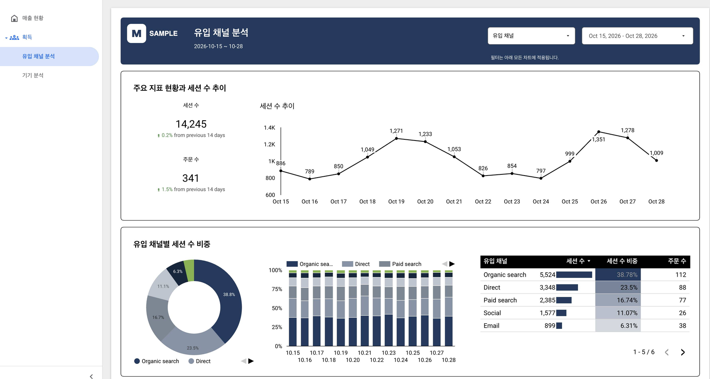
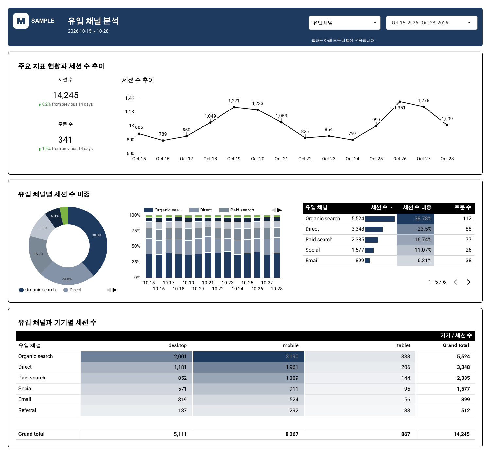
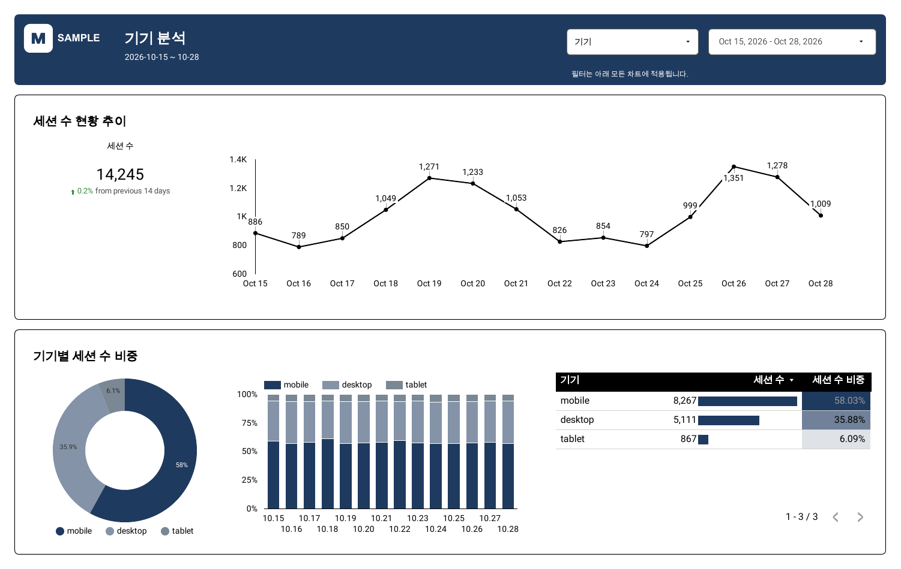

<div align="center">

# Looker Studio MCP

AI 에이전트가 Looker Studio 보고서를 직접 만들고 고치는 MCP 서버

[](LICENSE)




</div>

<br>

Looker Studio는 보고서를 편집하는 API를 공개하지 않습니다. 그래서 보고서 자동화는 보통 편집기 화면을 클릭하는 스크립트로 하게 되는데, 느리고 잘 깨집니다.

이 서버는 다르게 접근합니다. 로그인된 Chrome에 Playwright로 붙은 다음, 편집기가 내부에서 쓰는 API를 그대로 호출합니다. 클릭을 흉내 내지 않으니 빠르고, 창이 뒤에 가 있어도 됩니다. 위 보고서는 `component_report_add` 호출 한 번으로 나온 결과입니다.

> [!WARNING]
> 공개되지 않은 내부 API를 씁니다. Google이 지원하거나 보증하는 방식이 아니고, Looker Studio가 바뀌면 예고 없이 깨질 수 있습니다.

## 할 수 있는 것

- 보고서 생성, 복사, 페이지 추가와 정리
- BigQuery(테이블, 뷰, SQL), Google Sheets, GA4 연결
- 차트, 필터, 텍스트, 이미지 추가와 수정. 계산 필드와 혼합 데이터도 됩니다
- 지표와 분류만 받아서 페이지 전체를 구성 (`component_report_add`)
- 테마, 브랜드 색, 왼쪽 메뉴 구성
- 차트 데이터 오류 점검, 페이지를 PDF/PNG로 렌더
- 버전 복원, 보고서를 JSON으로 내보내고 다시 적용

도구는 65개입니다. 목록은 [아래](#도구)에 있습니다.

## 설치

Node.js 20 이상과 Google Chrome이 필요합니다.

```sh
git clone https://github.com/Hurdlers/looker-studio-mcp-playwright.git
cd looker-studio-mcp-playwright
npm install
npm run build
```

처음 한 번 로그인합니다. 평소 쓰는 Chrome과 분리된 전용 프로필 창이 뜨니 거기서 Google 계정으로 로그인하면 됩니다.

```sh
node build/cli.js login
npm run doctor   # 잘 붙었는지 확인
```

그다음 쓰는 클라이언트에 등록합니다.

```sh
# Claude Code
claude mcp add looker-studio -- node "$PWD/build/cli.js" serve

# Codex
codex mcp add looker-studio -- node "$PWD/build/cli.js" serve
```

<details>
<summary>Claude Desktop, Cursor 등 설정 파일로 등록하는 경우</summary>

```json
{
  "mcpServers": {
    "looker-studio": {
      "command": "node",
      "args": ["/absolute/path/to/looker-studio-mcp-playwright/build/cli.js", "serve"]
    }
  }
}
```

</details>

처음에는 읽기 도구만 보입니다. 편집까지 하려면 `~/.looker-studio-mcp/config.json`에 아래 한 줄을 넣고 서버를 다시 연결하세요.

```json
{ "writes_enabled": true }
```

BigQuery를 쓸 거라면 `gcloud auth application-default login`도 해 둬야 합니다. Sheets와 GA4는 브라우저 로그인만으로 됩니다.

## 써 보기

에이전트에게 평소 말하듯 요청하면 됩니다.

> 이 테이블로 보고서 만들어 줘. 첫 페이지는 매출, 주문 수, 세션 수 현황이고 그다음에 유입 채널별, 기기별 분석 페이지. 최근 2주 기준으로 직전 기간 대비 증감도 보여 주고, 브랜드 색은 #1F3A5F.

그러면 에이전트가 `report_create`로 데이터를 연결하고 `component_report_add`를 이렇게 부릅니다.

```json
{
  "report_id": "<보고서 ID>",
  "date": "날짜",
  "date_range": "2026-10-15..2026-10-28",
  "comparison": "Previous period",
  "brand_color": "#1F3A5F",
  "pages": [
    { "name": "매출 현황",
      "metrics": [{ "field": "매출", "aggregation": "sum" },
                  { "field": "주문 수", "aggregation": "sum" },
                  { "field": "세션 수", "aggregation": "sum" }],
      "dimensions": ["기기"] },
    { "name": "유입 채널 분석", "section": "획득",
      "metrics": [{ "field": "세션 수", "aggregation": "sum" }],
      "dimensions": ["유입 채널"],
      "cross": [{ "row": "유입 채널", "column": "기기" }] },
    { "name": "기기 분석", "section": "획득",
      "metrics": [{ "field": "세션 수", "aggregation": "sum" }],
      "dimensions": ["기기"] }
  ]
}
```

<table>
<tr>
<td valign="top"></td>
<td valign="top"></td>
</tr>
</table>

차트 종류는 데이터를 보고 정합니다. 분류 값이 6개 이하면 도넛과 표, 12개까지는 순위 막대, 그보다 많으면 표만 씁니다. 요청하지 않은 지표를 알아서 끼워 넣지는 않습니다. 저장 전에 구성만 보고 싶으면 `preview: true`를 주면 됩니다.

만든 뒤에는 `report_check`로 차트에 오류가 없는지 보고, `report_render`로 화면을 뽑아 확인하는 흐름을 권합니다.

## 도구

읽기 22개, 쓰기 43개입니다. 도구별 입력과 옵션은 [docs/reference.md](docs/reference.md)에 정리해 두었습니다.

<details>
<summary><b>보고서와 연결</b> (7)</summary>

| 도구 | 하는 일 | 구분 |
|---|---|---|
| `connection_check` | 전용 브라우저, Looker Studio 로그인, ADC와 현재 설정 확인 | 읽기 |
| `report_list` | 접근 가능한 보고서 목록과 이름 검색 | 읽기 |
| `report_create` | BigQuery·Google Sheets 소스를 연결한 새 보고서 생성 | 쓰기 |
| `report_copy` | 보고서 복사와 선택한 데이터 연결 교체 | 쓰기 |
| `report_rename` | 보고서 제목 변경 | 쓰기 |
| `report_delete` | `confirm_name`이 현재 제목과 같으면 보고서를 휴지통으로 이동 | 쓰기 |
| `report_link_build` | BigQuery·Google Sheets 연결을 지정한 보고서 생성 URL 작성 | 읽기 |

</details>

<details>
<summary><b>페이지</b> (5)</summary>

| 도구 | 하는 일 | 구분 |
|---|---|---|
| `page_list` | 페이지 이름, ID, 순서와 보기 화면 표시 여부 조회 | 읽기 |
| `page_add` | 빈 페이지 추가 | 쓰기 |
| `page_rename` | 페이지 이름 변경 | 쓰기 |
| `page_edit` | 페이지 복제, 삭제, 순서와 보기 화면 표시 여부 변경 | 쓰기 |
| `page_settings_update` | 페이지·보고서의 기본 데이터, 기간, 필터와 페이지 배경·크기 설정 | 쓰기 |

</details>

<details>
<summary><b>데이터 소스와 필드</b> (14)</summary>

| 도구 | 하는 일 | 구분 |
|---|---|---|
| `datasource_list` | 데이터 연결, 별칭, 사용처와 선택적으로 필드 조회 | 읽기 |
| `connector_list` | 생성 가능한 커넥터와 연결 방식·미지원 범위 조회 | 읽기 |
| `datasource_add` | BigQuery 테이블·뷰·사용자 SQL 또는 Google Sheets 연결 | 쓰기 |
| `datasource_remove` | 사용처를 확인한 뒤 보고서에서 데이터 소스 제거 | 쓰기 |
| `datasource_refresh` | 연결된 BigQuery·Google Sheets·GA4의 열 변경을 필드 목록에 반영 | 쓰기 |
| `datasource_query` | 연결된 데이터 소스의 측정기준·지표 값을 차트 저장 없이 조회 | 읽기 |
| `datasource_update` | 소스 이름, SQL, 인증 방식, 갱신 주기와 재사용 여부 변경 | 쓰기 |
| `field_update` | 필드 이름, 데이터 유형과 기본 집계 변경 | 쓰기 |
| `calculated_field_add` | 수식을 검증한 뒤 계산 필드 추가 | 쓰기 |
| `group_field_add` | 조건에 따라 값을 묶는 그룹 필드 추가 | 쓰기 |
| `bin_field_add` | 숫자를 일정한 간격으로 나누는 구간 필드 추가 | 쓰기 |
| `parameter_add` | 유형, 기본값과 허용값을 가진 매개변수 추가 | 쓰기 |
| `blend_create` | 2~5개 데이터 소스의 필드를 조인한 혼합 데이터 생성 | 쓰기 |
| `report_filter_edit` | 저장된 필터 수정, 이름 변경, 복제와 삭제 | 쓰기 |

</details>

<details>
<summary><b>차트와 요소</b> (14)</summary>

| 도구 | 하는 일 | 구분 |
|---|---|---|
| `chart_add` | 유형, 필드, 집계, 위치와 표시 옵션을 지정해 차트 추가 | 쓰기 |
| `community_viz_add` | 갤러리 이름이나 매니페스트로 커뮤니티 시각화 추가 | 쓰기 |
| `control_add` | 필터, 기간, 차원·매개변수 선택기와 버튼 추가 | 쓰기 |
| `component_list` | 페이지와 보고서 공통 요소의 ID, 종류와 위치 조회 | 읽기 |
| `component_inspect` | 요소의 데이터, 필드, 정렬, 필터와 스타일 상세 조회 | 읽기 |
| `component_delete` | ID로 지정한 요소와 그 조건부 서식 삭제 | 쓰기 |
| `component_update` | 요소의 설정, 위치, 크기, 앞뒤 순서와 보고서 공통 여부 변경 | 쓰기 |
| `component_duplicate` | 설정을 보존해 요소 복제 | 쓰기 |
| `component_arrange` | 요소 정렬, 간격 맞춤, 그룹과 그룹 해제 | 쓰기 |
| `text_add` | 서식 있는 텍스트 추가 | 쓰기 |
| `shape_add` | 도형 추가 | 쓰기 |
| `line_add` | 선과 화살표 추가 | 쓰기 |
| `image_add` | URL, 파일 또는 데이터 URI의 이미지 추가 | 쓰기 |
| `embed_add` | 외부 콘텐츠 삽입 | 쓰기 |

</details>

<details>
<summary><b>보고서 자동 구성</b> (9)</summary>

| 도구 | 하는 일 | 구분 |
|---|---|---|
| `component_template_list` | 준비된 디자인을 이름·용도·검색어로 찾고 검증 상태 조회 | 읽기 |
| `component_template_inspect` | 디자인의 데이터 역할·자료형·제목·기간·테마 조건 조회 | 읽기 |
| `component_template_plan` | 분석 목적에 맞는 공통 구조 추천·필드 검증·생성/수정 실행 계획 | 읽기 |
| `component_template_add` | 고객 필드를 연결해 검증된 디자인을 보고서에 추가 | 쓰기 |
| `component_template_update` | 기존 공통 차트·섹션·메뉴를 전체 구성 입력으로 수정 | 쓰기 |
| `component_template_patch` | 같은 소스의 측정항목만 바꾸고 기존 설정 유지 | 쓰기 |
| `component_page_outline` | 고른 지표와 분류의 실제 값 개수를 읽어 페이지의 분석 영역 구성을 제안 | 읽기 |
| `component_page_add` | 빈 페이지에 차트·요약 섹션·분석 영역·사이드바를 자동 배치하고 크기 계산 | 쓰기 |
| `component_report_add` | 여러 페이지를 만들어 메뉴 구역으로 묶고 페이지마다 분석 영역을 제안·구성 | 쓰기 |

</details>

<details>
<summary><b>테마</b> (1)</summary>

| 도구 | 하는 일 | 구분 |
|---|---|---|
| `theme_update` | 기본 테마, 색·글꼴, 탐색 메뉴, 레이아웃과 캔버스 변경 | 쓰기 |

</details>

<details>
<summary><b>점검과 화면</b> (4)</summary>

| 도구 | 하는 일 | 구분 |
|---|---|---|
| `report_check` | 차트의 데이터 오류, 빈 결과, 잘못된 필드와 동의 필요 여부 확인 | 읽기 |
| `report_render` | 서버에서 페이지를 PDF와 선택적으로 PNG로 렌더 | 읽기 |
| `report_data_refresh` | 보고서의 데이터 새로고침 요청; 차트·열 구조·게시 상태 유지 | 쓰기 |
| `report_show` | 브라우저에서 페이지를 열고 선택적으로 화면 캡처 | 읽기 |

</details>

<details>
<summary><b>버전과 이식</b> (5)</summary>

| 도구 | 하는 일 | 구분 |
|---|---|---|
| `version_list` | 보고서의 저장된 버전 목록 조회 | 읽기 |
| `version_restore` | 선택한 보고서 버전 복원 | 쓰기 |
| `report_spec_export` | 보고서를 이식 가능한 JSON 명세로 내보내기 | 읽기 |
| `report_spec_apply` | JSON 명세로 새 보고서 생성 또는 기존 보고서의 빠진 항목 추가 | 쓰기 |
| `batch_apply` | 보고서 편집 도구 목록을 사전 검사하고 순서대로 실행 | 쓰기 |

</details>

<details>
<summary><b>BigQuery</b> (6)</summary>

| 도구 | 하는 일 | 구분 |
|---|---|---|
| `bq_dataset_list` | 프로젝트의 BigQuery 데이터셋 조회 | 읽기 |
| `bq_table_list` | 데이터셋의 테이블과 뷰 조회 | 읽기 |
| `bq_table_describe` | 스키마, 테이블 정보와 뷰 SQL 조회 | 읽기 |
| `bq_query_run` | 읽기 전용 SELECT·WITH 실행 또는 쿼리 검증 | 읽기 |
| `bq_view_create` | 검증한 SELECT를 BigQuery 뷰로 저장·교체 | 쓰기 |
| `bq_view_delete` | 이 서버가 만든 것으로 표시된 BigQuery 뷰 삭제 | 쓰기 |

</details>

## 설정

`~/.looker-studio-mcp/config.json`에 둡니다. 전부 선택 사항입니다.

| 항목 | 설명 | 기본값 |
|---|---|---|
| `writes_enabled` | 쓰기 도구 등록 여부 | `false` |
| `dry_run` | 쓰기 도구가 실제로 바꾸지 않고 계획만 반환 | `false` |
| `billing_project` | BigQuery 쿼리를 실행할 프로젝트 | ADC의 프로젝트 |
| `location` | BigQuery 위치 | 테이블 위치 |
| `max_rows` | 쿼리 결과 최대 행 수 | `500` |
| `max_bytes_billed` | 쿼리 과금 바이트 상한 | `1000000000` |
| `chrome_path` | Chrome 실행 파일 경로 | 자동 탐색 |
| `headless` | 창 없이 실행 | `false` |

폴더 위치를 바꾸려면 환경 변수 `LOOKER_STUDIO_MCP_HOME`을 지정합니다.

## 주의할 점

쓰기를 켜면 로그인한 계정이 편집할 수 있는 보고서는 전부 고칠 수 있습니다. 서버가 대상을 가려 주지 않으니 테스트는 복사본에서 하세요.

보고서를 고치기 전에는 항상 버전을 하나 남깁니다. 잘못됐으면 `version_restore`로 되돌리면 됩니다. 다만 되돌아가는 건 보고서 문서뿐이고, 데이터 소스의 필드나 SQL을 바꾼 것, BigQuery 뷰를 만든 것은 그대로 남습니다. 쓰기 호출은 `audit.ndjson`에 기록됩니다.

공유, 초대, 임베드 관련 도구는 일부러 넣지 않았습니다.

그 밖에 알려진 한계입니다.

- `report_check`가 정상이라고 해서 숫자가 맞다는 뜻은 아닙니다. 데이터 요청이 성공했는지만 봅니다
- PostgreSQL, MySQL, Google Ads 연결은 아직 없습니다
- macOS에서만 돌려 봤습니다. Windows, Linux, headless 실행은 확인하지 못했습니다

## 개발

```sh
npm test
npm run typecheck
npm run build
```

단위 테스트는 모의 브라우저로 돌아가서 Chrome 없이도 됩니다. 실계정 테스트와 커넥터 추가 방법은 [docs/reference.md](docs/reference.md)를 보세요.

## 라이선스

[MIT](LICENSE)
